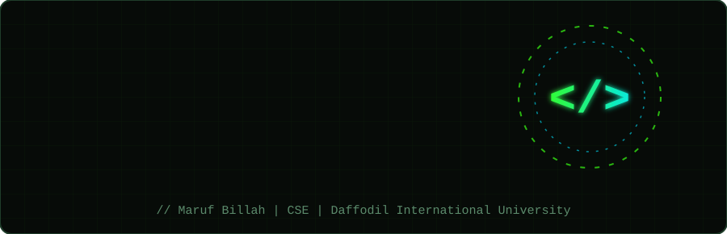

<div align="center">



<br/>


### **Code • Learn • Build • Debug • Repeat**
**`SyntaxMaruf` • <b>CSE</b> • <b>Daffodil International University</b>** <br><div align="center">

[](https://syntaxmaruf-portfolio.curlyriver4.chatgpt.site/)</div></br>


</div>

## 👨‍💻 About Me

Assalamualikum, I'm **Maruf Billah**, also known as **SyntaxMaruf**. I'm a Computer Science and Engineering student at **Daffodil International University**, and I'm training myself to think in code. <br>I love writing **C**, cracking problems on competitive programming platforms, and turning small ideas into programs that actually work. My dream is to become a **Cybersecurity Engineer** and an **AI Engineer**, so every day I sharpen the basics: logic, problem solving and clean code. Next on my list is **Python**.

🏫 **University:** Daffodil International University <br>
💻 **Department:** Computer Science & Engineering <br>
🧠 **Main Language:** C <br>
🎯 **Dream Goals:** Cybersecurity Engineer & AI Engineer <br>
🌱 **Currently Learning:** Data Structures, Problem Solving, Algorithms, etc. <br>
🐍 **Next Exploring:** Python, C++, Algorithms, Linux, Git workflow, etc.<br>
⚡ **Mindset:** Debug. Learn. Repeat.<br>
🚀 **Mission:**	Build real projects, not just tutorials.<br>


## 🗂️ My Coding Journey / Projects

| 📁 Repository | 📝 What's inside | 🛠️ Stack |
|:--|:--|:--:|
| [**Restaurant Order System**](https://github.com/SyntaxMaruf/Restaurant-Order-System) | My first complete C project, from menu to final cash memo. | `C` |
| [**DIU Bus Seat Booking System**](https://github.com/SyntaxMaruf/DIU-Bus-Seat-Booking-System) | Book DIU bus seats, calculate route fares, and cancel tickets. | `C` |
| [**Income & Expense Tracker**](https://github.com/SyntaxMaruf/Personal-Expense-Tracker) | Track income, record expenses, and see where your money goes. | `C` |
| [**Data Structures**](https://github.com/SyntaxMaruf/Lab-Evaluation-1) | A complete collection of linked list codes. | `C` |
| [**Google-Drive-Link**](https://drive.google.com/drive/folders/1-YyARXTjSfatbbp73LlySeIkidu5U5WP) | Notes, PDFs and extra resources in one place. | `Resources` |


<div align="center"></div>

## 🧰 Tech Arsenal

 ### 💻 Programming Languages
<br>


### 🛠️ Tools 
<br>


**🔭 On My Radar**


<div align="center"></div>

## 🏆 Achievements & Certificates

| 🎖️ Event | 📍 Result | 📜 Certificate |
|---|---|---|
| **AI Dev Fest 2026** | Attended the **Prompt Battle** | ✅ Received |
| **TAKE OFF Programming Contest** | Preliminary: **40th** · Final Round: **32nd** | ✅ Received |

<div align="center"></div>

## 📈 Skill Loading Bars

<pre style="font-size: 16px;">
C Programming      ▰▰▰▰▰▰▰▰▱▱  80%   ← main weapon
Problem Solving    ▰▰▰▰▰▰▰▱▱▱  70%   ← loading...
Data Structures    ▰▰▰▰▰▰▰▰▰▱  90%   ← main weapon
Algorithms         ▰▰▱▱▱▱▱▱▱▱  20%   ← loading...
Git & GitHub       ▰▰▰▰▰▰▱▱▱▱  60%   ← loading...
Linux              ▰▱▱▱▱▱▱▱▱▱  10%   ← loading...
Python             ▰▱▱▱▱▱▱▱▱▱  10%   ← loading...
</pre>

<div align="center"></div>

## 🧩 Problem Solving Arena

(https://toph.co/u/techie_Maruf)
 


## 🗺️ Roadmap

- [x] 🧱 Write first C programs & solve problems
- [x] 📦 Organize lab codes on GitHub
- [ ] 🧩 Master Data Structures (Array, Linked List, Stack, Queue, Tree, Graphs)
- [ ] ⚙️ Practice Algorithms (Sorting, Searching, Recursion)
- [ ] 🛠️ Build a real C/C++ project (not a tutorial)
- [ ] 🐧 Get comfortable with Linux & terminal
- [ ] 🌍 Contribute to an open-source project

<div align="center"></div>

## 📊 GitHub Analytics

<div align="center">


</div>

<div align="center"></div>

## 🐍 Contribution Snake

<div align="center">



</div>

<div align="center"></div>

## 🏆 Trophies

<div align="center">


</div>

<div align="center"></div>

## 💡 Developer Philosophy

```c
while (!master) {
    read_the_error_message();   // errors are friends, not enemies
    debug_with_patience();
    write_cleaner_code();
    commit_daily();
}
```

> ***"Today's small code is tomorrow's big software."***

<div align="center"></div>

## 🌐 Let's Connect

<div align="center">

[](https://www.linkedin.com/in/)
[](https://github.com/SyntaxMaruf)
[](mailto:billahmaruf540@gmail.com)
[](https://facebook.com/syntaxmaruf)


<br/>



### **Thanks for stopping by! ⭐ A star would make my day.**

</div>