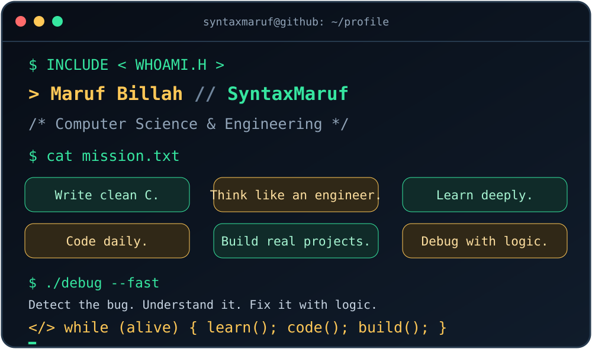
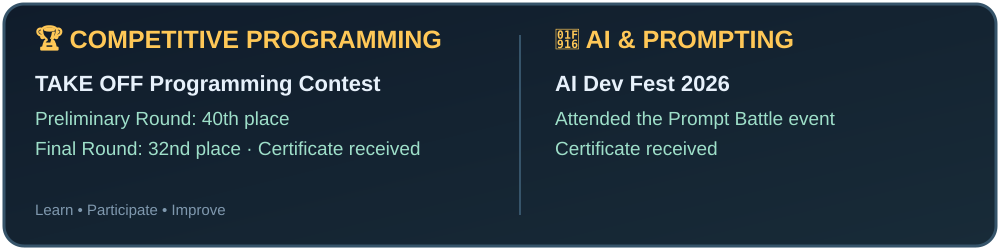

<div align="center">



# 👋 Hey, I'm Maruf Billah!
### `SyntaxMaruf` · CSE Student · Aspiring AI & Cybersecurity Engineer

**Welcome to my GitHub homepage!**

[](https://github.com/SyntaxMaruf)
[](https://www.linkedin.com/)
[](https://github.com/SyntaxMaruf)

</div>

---

## 🧑‍💻 About Me

Assalamualaikum! I'm **Maruf Billah**, but online I go by **SyntaxMaruf**. 👋

I study **Computer Science & Engineering at Daffodil International University**. I enjoy turning a messy problem into clean logic, understanding how things work behind the scenes, and improving my coding skills one step at a time.

Right now, I'm strengthening my **C programming fundamentals**, practicing **problem solving**, and learning the core concepts of **Data Structures and Algorithms**. My long-term goal is to grow into an engineer who can build useful software and explore the fields of **Artificial Intelligence and Cybersecurity**.

- 🎓 **University:** Daffodil International University
- 💻 **Department:** Computer Science & Engineering
- 🎯 **Career Goal:** AI Engineer & Cybersecurity Engineer
- 🧩 **Practicing:** Problem Solving, Data Structures, Algorithms
- 🐍 **Exploring Next:** Python, C++, Algorithms, Linux and Git workflow
- 🔨 **Next Step:** Turning my lab code and ideas into real projects
- ⚡ **Motto:** Debug. Learn. Build. Repeat.
- 💬 **Ask me about:** C programming, lab codes and learning CSE step by step

---

## 💡 Developer Philosophy

```c
while (alive) {
    learn_deeply();
    think_like_an_engineer();
    write_clean_code();
    debug_with_patience();
    build_real_projects();
}
```

> “Good code is not just written. It is understood, tested, and improved.”

---

## 🧰 Tech Arsenal

### 💻 Languages

<p>
  
  
  
  
  
</p>

### ⚙️ Tools & Workflow

<p>
  
  
  
  
  
</p>

### 🔭 On My Radar

`Data Structures & Algorithms` · `C++` · `Python` · `Linux` · `Web Development` · `AI` · `Cybersecurity`

---

## 🗂️ My Repositories

| Repository | What's inside | Stack |
|---|---|---|
| [CSE124-in-Lab-Codes](https://github.com/SyntaxMaruf/CSE124-in-Lab-Codes) | In-lab C programming codes and practice | `C` |
| [Lab-Evaluation-1](https://github.com/SyntaxMaruf/Lab-Evaluation-1) | Lab evaluation solutions and practice files | `C` |
| [Google-Drive-Link](https://github.com/SyntaxMaruf/Google-Drive-Link) | Notes, PDFs and additional learning resources | `Resources` |

---

## 📈 Skill Loading Bars

*An honest snapshot of my learning journey — not professional proficiency ratings.*

| Area | Progress |
|---|---|
| C Programming | `██████░░░░` Building foundations |
| Problem Solving | `█████░░░░░` Practicing regularly |
| Data Structures | `████░░░░░░` Learning and implementing |
| Algorithms | `███░░░░░░░` Exploring fundamentals |
| Git & GitHub | `████░░░░░░` Using in coursework |
| C++ / Python | `██░░░░░░░░` Exploring |

---

## 🧠 Problem Solving & Coding Platforms

I practice programming problems to improve my logic, implementation skills and speed.

<p>
  <a href="https://toph.co/"></a>
  <a href="https://vjudge.net/"></a>
  <a href="https://codeforces.com/"></a>
  <a href="https://leetcode.com/"></a>
  <a href="https://www.beecrowd.com.br/"></a>
</p>

> TOPh: **200+ problems solved**. I also practice on VJudge, Codeforces, LeetCode and beecrowd.

*Platform profile links can be personalized after adding your exact usernames.*

---

## 🏅 Achievements & Participation



- 🥇 **TAKE OFF Programming Contest** — 40th position in the Preliminary Round and 32nd position in the Final Round; received a certificate for the final round.
- 🤖 **AI Dev Fest 2026** — Attended the Prompt Battle event and received a certificate.

*These are participation and contest results, not claims of a professional award or job title.*

---

## 🗺️ Roadmap

- [ ] 🧱 Strengthen C programming fundamentals
- [ ] 📦 Organize lab codes and practice projects on GitHub
- [ ] 🧩 Master Data Structures (Array, Linked List, Stack, Queue, Tree)
- [ ] ⚙️ Practice Algorithms (Sorting, Searching, Recursion)
- [ ] 🛠️ Build a real C/C++ project
- [ ] 🐧 Get comfortable with Linux and the terminal
- [ ] 🌍 Contribute to an open-source project

---

## 📊 GitHub Analytics

<div align="center">
  
  
  
</div>

---

## 🐍 Contribution Snake

<div align="center">
  
</div>

---

## 🌐 Let's Connect

- **GitHub:** [@SyntaxMaruf](https://github.com/SyntaxMaruf)
- **LinkedIn:** [Maruf Billah](https://www.linkedin.com/)

<div align="center">


**Thanks for visiting my profile!** ⭐

</div>
